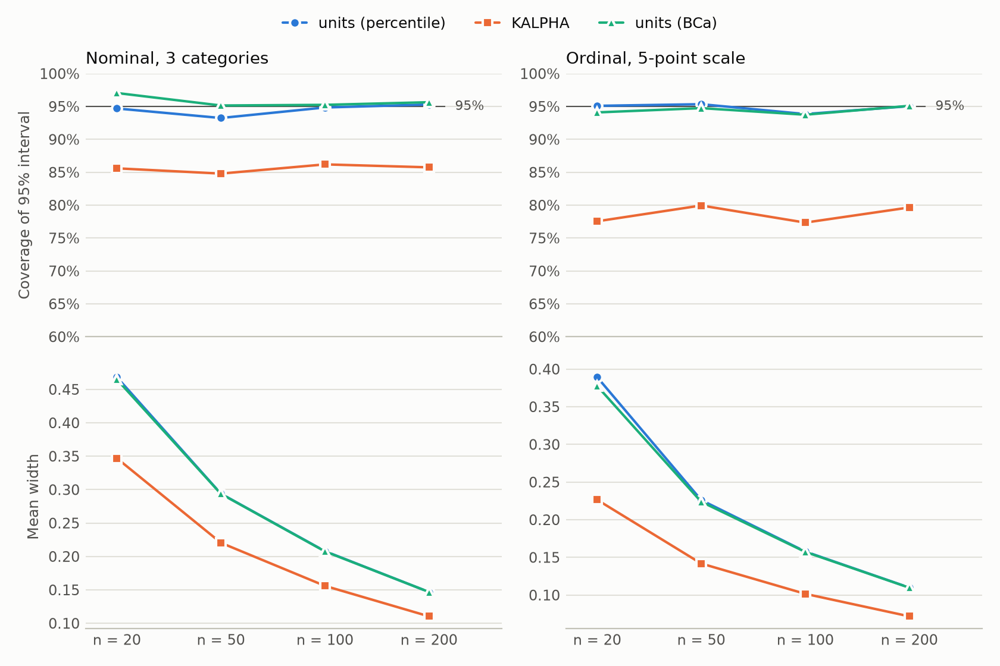
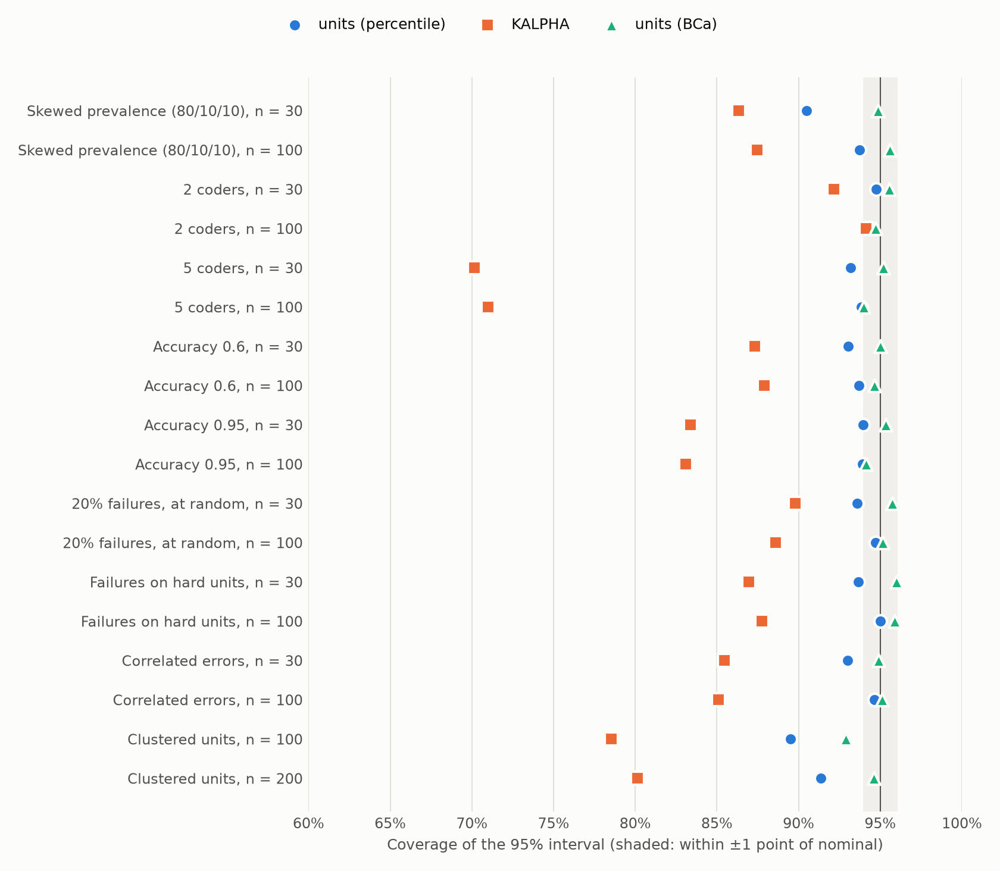
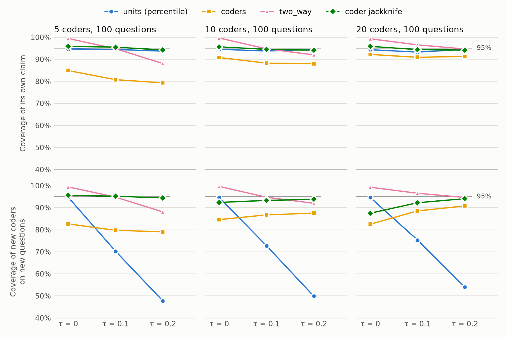

<!-- Generated by simulations/report.py from simulations/results; edit simulations/templates/bootstrap-coverage.md instead. -->

# Bootstrap coverage: which interval to trust

reliability-lab requires you to name a bootstrap scheme; there is no default. This page measures how often each scheme's 95% interval actually contains the true alpha, so you can choose one knowing what it does. The tables, charts and every number quoted in the text come from the committed runs in `simulations/results/` and `simulations/results/coders/`.

## Summary

- **Decide whose reliability you are claiming.** The units interval is about the coders in the study.
  - When coders differ persistently, it covers new coders on new questions in as few as 48% of runs.
  - For a claim about coders like these, use `scheme="two_way"` with 10 or more coders: it covers 92–98% when coders differ, and errs on the wide side when they do not.
  - For these questions with other coders, use `coder_jackknife()`: it covers 94–96%.
  - The `coders` bootstrap is too narrow (79–92%).
  - Repeated runs of one judge configuration do not differ persistently, so the units interval covers them. See [Generalising over coders](#generalising-over-coders).
- **Use `scheme="units"` for the coders you have.** It resamples whole units, or whole groups when a `group` is declared. Percentile intervals cover 93–95% across the scenarios with independent units. The exceptions are small samples with a dominant category (about 90%) and clustered data resampled unit by unit (89–91%).
- **`method="bca"` is the most accurate interval measured.** It covers between 93.8% and 97.0% in every scenario except 20 clusters (92.9%), and its misses are balanced on both sides. On this evidence it is no longer flagged experimental. It fails to produce an interval in some small, skewed samples: 18% of runs at n = 30 with an 80% category. The library warns when that happens, and `method="percentile"` still gives an interval from the defined replicates.
- **KALPHA is too narrow whenever a unit holds more than one pair of values.** It covers 85–86% with three coders on nominal data, 77–80% on a 5-point ordinal scale, and 70–71% with five coders. With two coders, where each unit holds one pair, it covers 92–94%. Use it to reproduce published KALPHA intervals, not for new claims.
- **Declare groups when units share a source.** Resampling units of clustered data one by one covers 89–91%. Resampling groups covers 91.8% with 20 clusters and 94.5% with 40.
- **No interval repairs informative failures.** When failed attempts concentrate on hard units, dropping them raises alpha by about 0.03. The intervals cover that inflated value correctly, but not the complete-data alpha. Report the missing-data policies side by side, and read their spread as sensitivity to the policy, not as bounds.

## Setup

**Data.** Each scenario generates ratings from a latent-class "know or guess" model:
- Every unit has a true category. Each coder reports it with probability `accuracy`, otherwise guesses. A guess is a draw from the prevalences (nominal), or a shift of one or two scale points (ordinal, 5 points).
- About 30% of units are hard, with accuracy lowered by 0.25.

Variations:
- skewed prevalence;
- 2 or 5 coders instead of 3;
- lower or higher accuracy;
- errors shared between coders (a coder who guesses copies the unit's shared wrong value with probability 0.5, as models of one family might);
- 20% failed attempts, at random or concentrated on hard units;
- clusters of 5 units, which share hardness and, with probability 0.7, a topic.

**Truth.** The true alpha of a scenario is the estimator's population value: alpha on 200,000 units from the same process, with failures treated as missing. The complete-data alpha (before failures) is computed the same way.

**Schemes.** Every replication is bootstrapped with:
- `units` percentile at unit level;
- `units` percentile at group level (clustered scenarios);
- `kalpha`;
- `units` with BCa at the default level (groups when declared).

All use 2,000 resamples and 95% intervals.

**Run.** 26 scenarios × 2,000 replications × 2,000 bootstrap resamples, seed 20261027, reliability-lab 0.1.0 (numpy 2.5.4, scipy 1.18.1, pandas 3.1.0); 21 minutes on 8 workers. The largest Monte Carlo error of a population alpha is 0.0025, and a coverage near 95% has a Monte Carlo standard error of about 0.5%.

**How to read.** Coverage is the share of replications whose interval contains the true alpha; 95% is the target. Below 93% means the intervals are too narrow to support a 95% claim. "Below / above" splits the misses: an interval entirely below the truth, or entirely above it. Width is the price of coverage: a narrow interval that misses is not a better interval.

## Sample size and level of measurement

<picture>
  <source media="(prefers-color-scheme: dark)" srcset="figures/coverage_by_n-dark.png">
  
</picture>

| Scenario | True alpha | units (percentile) coverage | KALPHA coverage | units (BCa) coverage | units (percentile) width | KALPHA width | units (BCa) width |
| --- | --- | --- | --- | --- | --- | --- | --- |
| Nominal (baseline), n = 20 | 0.540 | 94.7% | 85.6% | 97.0% | 0.47 | 0.35 | 0.47 |
| Nominal (baseline), n = 50 | 0.540 | 93.2% | 84.8% | 95.2% | 0.29 | 0.22 | 0.29 |
| Nominal (baseline), n = 100 | 0.540 | 94.8% | 86.2% | 95.2% | 0.21 | 0.16 | 0.21 |
| Nominal (baseline), n = 200 | 0.539 | 95.3% | 85.8% | 95.7% | 0.15 | 0.11 | 0.15 |
| Ordinal 5-point, n = 20 | 0.782 | 95.1% | 77.5% | 94.1% | 0.39 | 0.23 | 0.38 |
| Ordinal 5-point, n = 50 | 0.782 | 95.3% | 80.0% | 94.8% | 0.23 | 0.14 | 0.22 |
| Ordinal 5-point, n = 100 | 0.780 | 93.8% | 77.3% | 93.8% | 0.16 | 0.10 | 0.16 |
| Ordinal 5-point, n = 200 | 0.782 | 95.0% | 79.7% | 95.1% | 0.11 | 0.07 | 0.11 |

- **Units, percentile and BCa:** both stay within about two points of 95% from 20 to 200 units, on nominal and ordinal data.
- **Small samples:** at n = 20–50, the percentile intervals miss more often below the truth than above (4–5% against 1–2% on nominal data). Small-sample alpha is biased low (−0.012 at n = 20), and BCa corrects for that.
- **KALPHA's widths:** its intervals are about a quarter narrower on nominal data and about 40% narrower on ordinal data, and coverage falls accordingly. Ordinal distances depend on the category marginals, which KALPHA holds fixed along with D_e.

## One factor at a time

<picture>
  <source media="(prefers-color-scheme: dark)" srcset="figures/coverage_by_factor-dark.png">
  
</picture>

| Scenario | True alpha | units (percentile) | KALPHA | units (BCa) | BCa undefined | Units below / above |
| --- | --- | --- | --- | --- | --- | --- |
| Skewed prevalence (80/10/10), n = 30 | 0.537 | 90.5% | 86.3% | 94.9% | 18.2% | 7.4% / 2.1% |
| Skewed prevalence (80/10/10), n = 100 | 0.540 | 93.8% | 87.5% | 95.6% | 0.0% | 4.7% / 1.6% |
| 2 coders, n = 30 | 0.540 | 94.8% | 92.2% | 95.5% | 0.0% | 3.1% / 2.1% |
| 2 coders, n = 100 | 0.537 | 94.4% | 94.2% | 94.7% | 0.0% | 2.5% / 3.0% |
| 5 coders, n = 30 | 0.537 | 93.2% | 70.2% | 95.2% | 0.0% | 5.4% / 1.4% |
| 5 coders, n = 100 | 0.540 | 93.8% | 71.0% | 94.0% | 0.0% | 4.2% / 1.9% |
| Accuracy 0.6, n = 30 | 0.287 | 93.0% | 87.3% | 95.0% | 0.0% | 5.3% / 1.7% |
| Accuracy 0.6, n = 100 | 0.289 | 93.7% | 87.9% | 94.7% | 0.0% | 4.1% / 2.2% |
| Accuracy 0.95, n = 30 | 0.778 | 94.0% | 83.4% | 95.3% | 0.1% | 2.2% / 3.9% |
| Accuracy 0.95, n = 100 | 0.778 | 93.9% | 83.1% | 94.2% | 0.0% | 2.4% / 3.8% |
| 20% failures, at random, n = 30 | 0.537 | 93.6% | 89.8% | 95.8% | 0.0% | 3.3% / 3.1% |
| 20% failures, at random, n = 100 | 0.540 | 94.7% | 88.6% | 95.2% | 0.0% | 2.9% / 2.4% |
| Failures on hard units, n = 30 | 0.570 | 93.7% | 87.0% | 96.0% | 0.0% | 3.7% / 2.6% |
| Failures on hard units, n = 100 | 0.573 | 95.0% | 87.8% | 95.9% | 0.0% | 3.0% / 2.0% |
| Correlated errors, n = 30 | 0.561 | 93.0% | 85.5% | 94.9% | 0.0% | 4.2% / 2.8% |
| Correlated errors, n = 100 | 0.559 | 94.7% | 85.1% | 95.1% | 0.0% | 3.4% / 1.9% |
| Clustered units, n = 100 | 0.537 | 89.5% | 78.5% | 92.9% | 0.0% | 7.0% / 3.5% |
| Clustered units, n = 200 | 0.540 | 91.3% | 80.2% | 94.6% | 0.0% | 5.4% / 3.2% |

- **Number of coders** decides KALPHA's fate. With 2 coders it covers 92–94%; with 5 coders, 70–71%. KALPHA resamples pairs of values as if they were independent. A unit rated by m coders contributes m(m − 1)/2 pairs, and those pairs share the unit's difficulty and true value. More coders mean more dependent pairs and a falsely narrow interval. Resampling units keeps each unit's pairs together, and its coverage does not depend on the number of coders.
- **Skewed prevalence** is the hardest case for small samples. Percentile covers 90.5% at n = 30, missing mostly below. BCa covers 94.9% when it produces an interval, but fails in 18% of runs: a resample can contain only the dominant category, which leaves alpha undefined. The library counts those replicates and raises a `BootstrapWarning` naming the estimate left without an interval; nothing is dropped silently.
- **Accuracy, random failures and correlated errors** move the alpha level, from 0.29 to 0.78. They leave the units scheme's coverage at 93–95%.

## Clustered units

| Units (clusters) | Scheme | Coverage | Mean width |
| --- | --- | --- | --- |
| 100 (20) | units (percentile) | 89.5% | 0.209 |
| 100 (20) | units, group level | 91.8% | 0.238 |
| 100 (20) | KALPHA | 78.5% | 0.157 |
| 100 (20) | units (BCa) (group level) | 92.9% | 0.236 |
| 200 (40) | units (percentile) | 91.3% | 0.147 |
| 200 (40) | units, group level | 94.5% | 0.169 |
| 200 (40) | KALPHA | 80.2% | 0.111 |
| 200 (40) | units (BCa) (group level) | 94.6% | 0.168 |

When units share a source (turns of one conversation, responses to one prompt), resampling units one by one treats dependent units as independent. Coverage falls to 89.5% with 20 clusters and 91.3% with 40. Resampling whole groups, the default whenever a `group` is declared, brings it to 91.8% and 94.5%. With few clusters, even group resampling under-covers somewhat, and BCa at group level (92.9% with 20 clusters) does slightly better. KALPHA cannot see clusters at all, and covers about 80%.

## Failed attempts

| Scenario | Complete-data alpha | Alpha with failures dropped | Gap | Units coverage of the dropped-failures value | Policy range covers complete-data alpha |
| --- | --- | --- | --- | --- | --- |
| 20% failures, at random, n = 30 | 0.537 | 0.537 | -0.001 | 93.6% | 48.9% |
| 20% failures, at random, n = 100 | 0.540 | 0.540 | -0.001 | 94.7% | 48.0% |
| Failures on hard units, n = 30 | 0.539 | 0.570 | +0.032 | 93.7% | 48.9% |
| Failures on hard units, n = 100 | 0.540 | 0.573 | +0.033 | 95.0% | 65.8% |

- **Failures at random** leave alpha where it was, within 0.001 of the complete-data value. Every scheme behaves as it does without failures.
- **Informative failures** are the LLM case: parse and provider errors concentrated on hard items.
  - Dropping them removes exactly the units where coders disagree, and alpha rises from 0.539 to 0.570–0.573.
  - The units intervals still cover the dropped-failures value, at 93.7–95.0%. But that value is not the complete-data reliability, and the 0.03 gap does not shrink with more units.
- **The spread of missing-data policies is not a bound.** Treating failures as their own category (`as_category`) gives a second, different estimate. The interval between the policies contained the complete-data alpha in only 48–66% of runs. Report the policies and the error rates side by side, and read their spread as how much the policy choice matters.

## Generalising over coders

In every scenario above, the coders are alike: they share one accuracy, so the only randomness is in which questions were drawn and in each rating. Real coders often differ persistently: one annotator is stricter, one model leans towards a label, one prompt is more careful. Then one study supports three different claims, and each needs its own interval.

| Claim | Interval | Resampled |
| --- | --- | --- |
| These coders, on new questions | `scheme="units"` | questions (or groups) |
| These questions, with new coders like these | `result.coder_jackknife()`, or `scheme="coders"` | coders |
| New coders like these, on new questions | `scheme="two_way"` | questions and coders |

Repeated runs of one judge configuration are the exception. Run 3 and run 7 differ only by chance, with no persistent difference between them, so they behave like the alike coders above. The units interval then already covers new runs.

**Setup.**
- **Coders differ by a spread τ.** Each coder's accuracy is 0.8 + τ·Z, with Z standard normal, clipped to [0.05, 1].
- **Each coder has a favourite.** When a coder guesses, with probability min(0.5, 2τ) it picks its own favourite category (nominal) or leans one point in its own direction (ordinal).
- **Grid.** τ = 0 reproduces the alike coders above; at τ = 0.2, the middle 95% of accuracies runs from about 0.4 to 1. The grid crosses τ ∈ {0, 0.1, 0.2} with 5, 10 or 20 coders and 50 or 100 questions on the nominal baseline. It adds one 5-point ordinal scenario with τ = 0.2, 10 coders and 100 questions.

Each replication draws a panel of coders and a set of questions. Every interval is scored against the claim it is built for, computed fresh for that replication:
- **Same coders, new questions.** Alpha of this panel on 20,000 new questions.
- **Same questions, new coders.** Alpha of these questions rated by 2,000 new coders.
- **New coders, new questions.** The population alpha. It is computed once per scenario, from 200,000 questions each rated by its own new coders.

**Run.** 19 scenarios × 2,000 replications × 2,000 bootstrap resamples, seed 20261027, reliability-lab 0.1.1 (numpy 2.5.4, scipy 1.18.1, pandas 3.1.0); 62 minutes on 8 workers. The largest Monte Carlo error of a population alpha is 0.0021, and a coverage near 95% has a Monte Carlo standard error of about 0.5%.

<picture>
  <source media="(prefers-color-scheme: dark)" srcset="figures/coverage_by_spread-dark.png">
  
</picture>

| Scenario | Population alpha | units: same coders | units: new coders | coders: same questions | jackknife: same questions | two_way: new coders and questions |
| --- | --- | --- | --- | --- | --- | --- |
| Nominal, τ = 0, 5 coders, n = 50 | 0.539 | 94.4% (0.23) | 94.3% | 85.0% (0.17) | 96.2% (0.30) | 99.8% (0.35) |
| Nominal, τ = 0, 5 coders, n = 100 | 0.539 | 94.7% (0.16) | 94.8% | 84.9% (0.13) | 95.9% (0.21) | 99.5% (0.25) |
| Nominal, τ = 0, 10 coders, n = 50 | 0.538 | 94.0% (0.17) | 94.1% | 90.1% (0.13) | 95.8% (0.17) | 99.5% (0.25) |
| Nominal, τ = 0, 10 coders, n = 100 | 0.539 | 94.5% (0.12) | 94.7% | 90.8% (0.09) | 95.7% (0.12) | 99.7% (0.18) |
| Nominal, τ = 0, 20 coders, n = 50 | 0.538 | 93.8% (0.13) | 94.0% | 92.0% (0.09) | 95.2% (0.11) | 99.4% (0.19) |
| Nominal, τ = 0, 20 coders, n = 100 | 0.539 | 94.3% (0.09) | 94.7% | 92.2% (0.07) | 95.9% (0.08) | 99.3% (0.13) |
| Nominal, τ = 0.1, 5 coders, n = 50 | 0.539 | 93.2% (0.22) | 78.4% | 81.5% (0.25) | 95.0% (0.44) | 96.7% (0.40) |
| Nominal, τ = 0.1, 5 coders, n = 100 | 0.538 | 94.5% (0.16) | 70.3% | 80.8% (0.22) | 95.5% (0.40) | 94.8% (0.31) |
| Nominal, τ = 0.1, 10 coders, n = 50 | 0.538 | 94.4% (0.17) | 81.1% | 88.1% (0.20) | 94.8% (0.26) | 97.6% (0.29) |
| Nominal, τ = 0.1, 10 coders, n = 100 | 0.537 | 93.8% (0.12) | 72.8% | 88.2% (0.17) | 94.5% (0.23) | 94.8% (0.23) |
| Nominal, τ = 0.1, 20 coders, n = 50 | 0.538 | 94.0% (0.13) | 82.6% | 90.5% (0.15) | 94.0% (0.17) | 97.9% (0.22) |
| Nominal, τ = 0.1, 20 coders, n = 100 | 0.538 | 93.2% (0.09) | 75.3% | 90.9% (0.13) | 94.4% (0.15) | 96.5% (0.18) |
| Nominal, τ = 0.2, 5 coders, n = 50 | 0.515 | 93.7% (0.22) | 60.3% | 79.1% (0.36) | 93.7% (0.65) | 91.0% (0.48) |
| Nominal, τ = 0.2, 5 coders, n = 100 | 0.516 | 93.7% (0.15) | 47.8% | 79.3% (0.34) | 94.2% (0.61) | 88.1% (0.41) |
| Nominal, τ = 0.2, 10 coders, n = 50 | 0.514 | 93.9% (0.16) | 63.2% | 88.2% (0.29) | 94.8% (0.38) | 95.7% (0.36) |
| Nominal, τ = 0.2, 10 coders, n = 100 | 0.515 | 94.5% (0.11) | 49.9% | 88.0% (0.28) | 94.1% (0.36) | 92.0% (0.31) |
| Nominal, τ = 0.2, 20 coders, n = 50 | 0.516 | 93.8% (0.13) | 67.5% | 92.1% (0.22) | 95.3% (0.25) | 96.0% (0.27) |
| Nominal, τ = 0.2, 20 coders, n = 100 | 0.515 | 94.5% (0.09) | 54.0% | 91.3% (0.21) | 94.2% (0.24) | 94.7% (0.24) |
| Ordinal, τ = 0.2, 10 coders, n = 100 | 0.803 | 95.1% (0.10) | 75.8% | 88.6% (0.12) | 94.4% (0.17) | 93.8% (0.17) |

Each cell gives the coverage of the interval's own claim, with the mean width in brackets. The "units: new coders" column scores the units interval against a claim it is not built for.

- **The units interval is about these coders.** It covers its own claim at 93–95% in every scenario.
  - Read as a claim about new coders, it holds only when coders are alike: 94–95% at τ = 0.
  - Once coders differ, it covers 70–83% at τ = 0.1 and 48–68% at τ = 0.2.
  - More questions make this worse, not better. The interval narrows around this panel's alpha, but the panel's own distance from the population does not shrink. More coders help only slowly.
- **`two_way` covers new coders on new questions.**
  - With 10 or 20 coders it covers 92–98%. With 5 coders at τ = 0.2 it covers 88–91%.
  - When coders are alike, it is conservative (99.3–99.8%) and about 1.5 times as wide as the units interval. It counts the rating noise twice, once through the questions and once through the coders, as pigeonhole bootstraps of crossed designs do (Owen 2007).
- **The coder jackknife covers these questions with new coders.**
  - It covers 93.7–96.2% in every scenario, including 5 coders.
  - With 5 coders its t interval, with 4 degrees of freedom, is wide: 0.61–0.65 at τ = 0.2, against 0.41–0.48 for `two_way`.
  - When coders differ strongly, the coders are most of the uncertainty, so it also covers new coders on new questions (93–95% at τ = 0.2). When coders are alike, it leaves out the questions' share and covers that claim at 87–96%.
- **The `coders` bootstrap is too narrow.** It covers 79–85% with 5 coders, 88–91% with 10 and 90–92% with 20. A percentile interval from m coders behaves like a bootstrap of m observations, which understates the spread when m is small. For this claim, use the jackknife.
- **Ordinal data follow the same pattern.** With τ = 0.2, 10 coders and 100 questions:
  - the units interval covers new coders in 75.8% of runs;
  - `two_way` covers them in 93.8%;
  - the jackknife covers its own claim at 94.4%.

**How many coders.** A claim about coders needs enough of them. With 5 coders, `two_way` under-covers when coders differ, and the jackknife covers but is wide. With 10 coders, `two_way` covers 92–98% when coders differ, and the jackknife covers 94–96%.

**Which coders drive alpha.** `result.coder_jackknife().influence` lists alpha without each coder, and each coder's influence. It shows whether one annotator, model or prompt drives the result. It describes the data; it is not a test of whether coders differ. Choose the claim, and so the interval, from the design, before looking at the results.

## Which scheme to use

| Situation | Use | Why |
| --- | --- | --- |
| Units independent, n of about 50 or more | `scheme="units"` (percentile) | 93–95% coverage; simplest |
| Small sample or a dominant category | `scheme="units", method="bca"` | corrects the low-alpha bias; if BCa warns that it has no interval, use percentile |
| Units share a source | declare `group`; `scheme="units"` resamples groups | unit resampling under-covers (89–91%) |
| Fewer than about 30 clusters | group resampling, read as approximate | 92% coverage with 20 clusters |
| Reproducing a published KALPHA interval | `scheme="kalpha"` | matches Krippendorff's algorithm; too narrow for new claims with 3 or more coders |
| Comparing two configurations | `study.compare()` | units scheme on identical resamples (KALPHA has no paired form) |
| Repeated runs of one judge configuration | `scheme="units"` | runs differ only by chance, so the interval already covers new runs |
| Coders differ (annotators, models, prompts), and the claim is about coders like them | `scheme="two_way"`, with 10 coders or more | units covers 48–83% of that claim; `two_way` covers 92–98% |
| These questions with other coders, or which coders drive alpha | `result.coder_jackknife()` | 94–96% coverage, and an influence table per coder; the `coders` bootstrap is too narrow |

## Limitations

- **One family of processes.** These scenarios use one family of data-generating processes (know or guess, with difficulty), up to 20 coders, up to 200 units, nominal and 5-point ordinal data, and 95% intervals. Interval and ratio metrics were not simulated.
- **Coders differ in one way.** In the coder grid, coders differ in accuracy and in a favourite label. Two other kinds of difference were not simulated beyond the one ordinal scenario: coders who use a scale differently, and coders who are good on some kinds of question and poor on others. Every coder rates every question, and no attempts fail.
- **Truth uncertainty.** The true alphas carry a Monte Carlo error of at most 0.0025, small next to interval widths of 0.07 and more.
- **BCa's undefined cases are real.** At n = 30 with an 80% category, one run in six produces no BCa interval.
- **KALPHA's second pick.** KALPHA's result depends on reading its algorithm note as evalica does: a unit's second pick is redrawn when it repeats the first. Its coverage problem does not come from that detail. It comes from treating dependent pairs as independent.

## Reproduce

```bash
uv run python -m simulations.run_coverage --workers 8                 # about 20 minutes on 8 cores
uv run python -m simulations.run_coverage --grid coders --workers 8  # about an hour on 8 cores
uv run --group sim python -m simulations.report                       # tables, figures and this page
```

The seeds and versions are recorded in `run_info.json` beside each `coverage.csv`. Each replication's seed depends only on its scenario and index, so a rerun reproduces every number.
